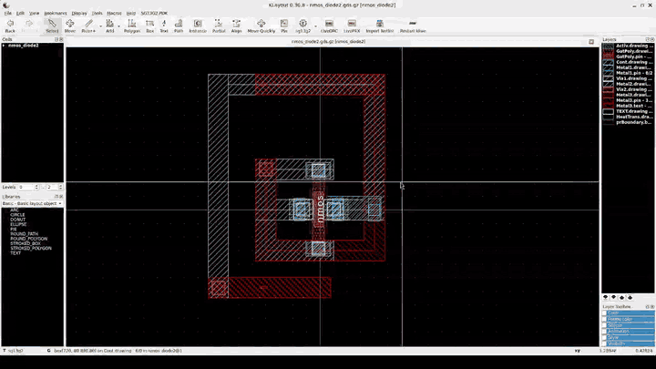
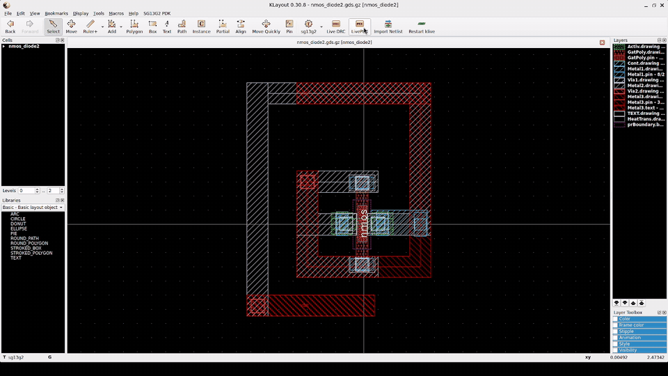
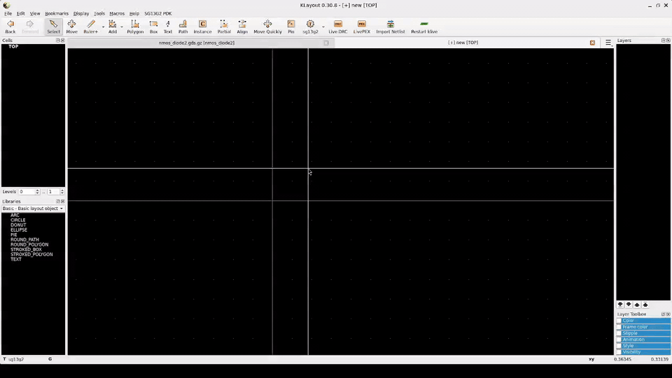
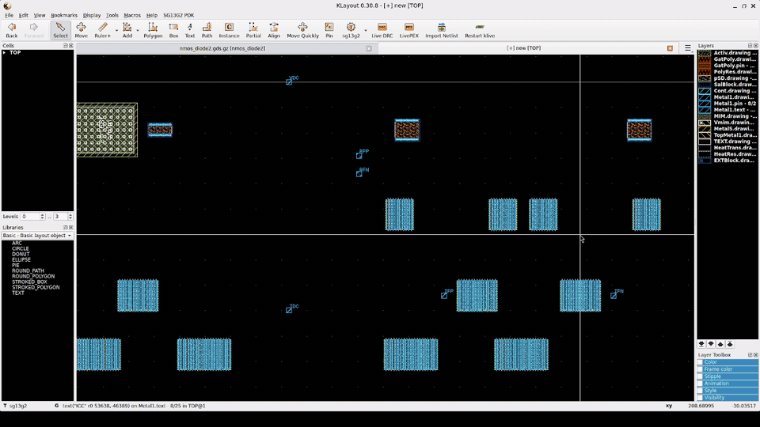

# N.A.T

### Netlist Aware Toolkit

**klayout-NAT is a KLayout package that brings the schematic into the layout: checks run as you draw,
parasitics are one click away, and the devices keep the names and nets of your netlist.**

- **LiveDRC:** runs the PDK DRC every time you save the layout and loads the report into the Marker Browser.
- **LivePEX:** runs a Magic parasitic extraction (CC, RC or R) of the current layout from a panel and shows
  the extracted netlist.
- **Import Netlist:** places an xschem SPICE netlist as IHP SG13G2 PCells, each one in a cell named after its
  SPICE instance, optionally at the same positions as in the schematic.
- **Update Netlist:** after a schematic change, lists the devices whose w/l changed and updates them in one
  undoable step.
- **Ratsnest:** select a device or a pin and lines show every device and pin that shares a net with it.
- **Nets stored in the layout:** device names, nets and pin directions are saved as GDS user properties.
- **Made for IIC-OSIC-TOOLS:** runs inside the [IIC-OSIC-TOOLS](https://github.com/iic-jku/IIC-OSIC-TOOLS)
  container, which already provides KLayout, the PDKs, Magic, xschem and klayout-pex.

## Status

Version 1.1. KLayout 0.29 or later with Python 3.9 or later.

| Tool | IHP SG13G2 | sky130A | You also need |
|---|---|---|---|
| LiveDRC | yes | no | the PDK's `run_drc.py`, `python3` |
| LivePEX (Magic) | yes | yes | Magic, the PDK's `.magicrc`, the `klayout-pex` Python package |
| Import Netlist / Update Netlist | yes | no | KLayout in editing mode (`klayout -e`) |
| Ratsnest | yes | no | a layout imported with Import Netlist |

## Install

1. In KLayout, open *Tools > Manage Packages* and install **klayout-NAT**, or copy this folder to the
   `salt` folder of your KLayout home (`~/.klayout/salt/`; `/headless/.klayout/salt/` in IIC-OSIC-TOOLS).
2. Restart KLayout. The **LiveDRC**, **LivePEX** and **Import Netlist** buttons appear at the end of the
   toolbar.

For LivePEX on sky130A, select that PDK before starting KLayout so that `PDK=sky130A` is set
(in IIC-OSIC-TOOLS: `sak-pdk sky130A`).

## Try it

1. Draw the schematic in xschem and write the SPICE netlist.
2. Start KLayout with `klayout -e` and create a layout with the `sg13g2` technology.
3. Click **Import Netlist**, choose the `.spice` file and, optionally, the `.sch` file, and click **OK**.
4. Select a device: the ratsnest lines show where it connects. Move the devices and route.
5. Turn on **LiveDRC** and save: the DRC markers appear after each save.
6. Click **LivePEX**, choose CC, RC or R and click **Magic** to get the extracted netlist.

## Documentation

- [doc/readme.html](doc/readme.html): user guide with every option, environment variable and output file.
  KLayout opens it from the *Documentation* link in *Tools > Manage Packages*.
- [ARCHITECTURE.md](ARCHITECTURE.md): how the modules fit together, for developers.

## Known limits

- LiveDRC calls the IHP SG13G2 `run_drc.py` and its options; other PDKs are not supported.
- Import Netlist only knows the IHP SG13G2 devices and needs KLayout in editing mode.
- Placement from xschem does not apply rotation or mirroring.
- The klayout-pex 2.5D and FasterCap engines are present but turned off.

## Credits

This toolkit is my undergraduate final project (Trabalho de Conclusão de Curso) in Electronic Engineering
at the Universidade de São Paulo (USP).

Thanks to the LSI, Laboratório de Sistemas Integráveis of the Escola Politécnica da USP, for the support.

Author: Flavio Midea.

## License

GPL-3.0-or-later. `import_netlist.py` and `ihp130_pcell_templates.py` are based on the IHP Open PDK
netlist importer (Apache-2.0, originally by Efabless Corporation). LivePEX uses
[klayout-pex](https://github.com/iic-jku/klayout-pex) and Magic.
